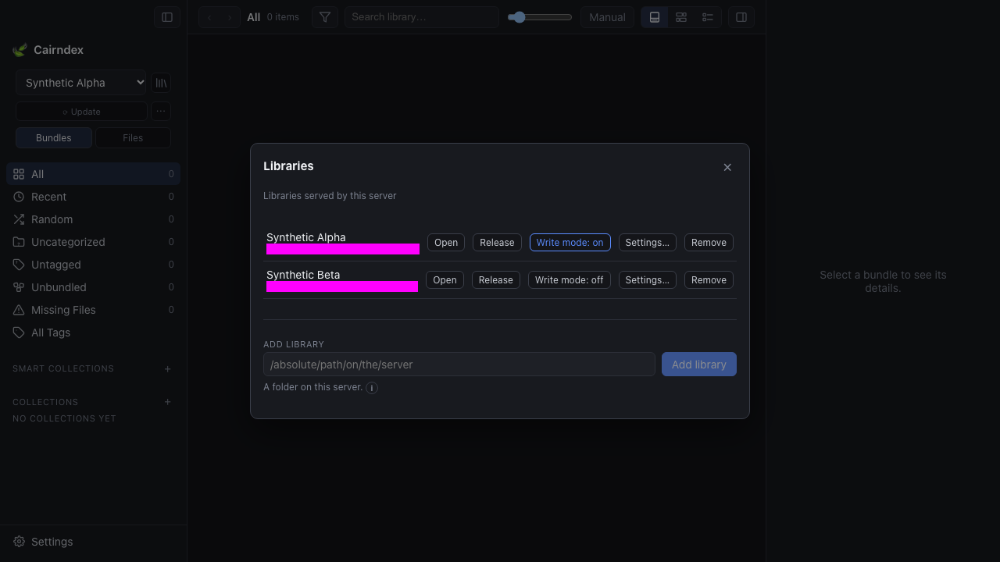
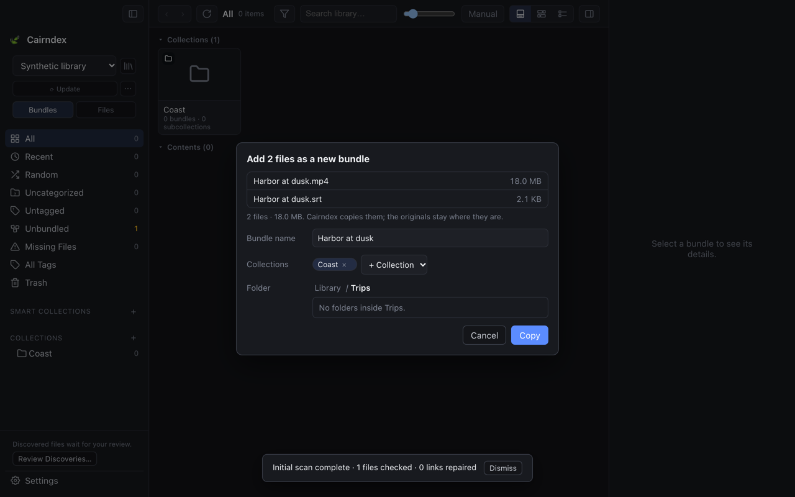

# Portable source operations

Copying files in, and **Rename…**, **Copy to…**, **Move to…** and **Move to Trash**
on library items, need that library's **Write mode**. Turn it on in **Libraries**, on
the serving instance; nothing else switches it. The deployment must permit writes. A
protected library requires its passphrase when enabling writes.

Turning write mode on asks for confirmation; turning it off takes effect at once
for an authorized session. A locked library asks for its passphrase. Released
libraries must be reopened before enabling writes. A read-only deployment keeps
the control visible and explains why it is blocked. Library **Settings…** opens
in its own dialog; closing it restores the list and its keyboard focus.

The File Browser and Unbundled list respond to write mode changes without a
restart. With write mode on, a file or folder's context menu holds **Rename…**,
**Copy to…**, **Move to…** and **Move to Trash**. **F2** or **Enter** renames a
single selected item, and so does a double-click on its name in the inspector.
**Delete** or **⌘⌫** asks to move the selection to the Trash. Each action asks
only what it needs (a name, a folder, or a confirmation for the Trash) and then
runs as a background task. Turning write mode off removes these actions.
Existing directory-size and source-safety limits still apply. Interrupted writes
retain their intent and show permission, read-only, full-storage or saved-login
failures specifically. Private job results retain numeric storage error codes
and the failed phase, without exception text or source paths. If macOS blocks
the saved network login, the library shows **Allow Access…**. Authorize it, then
choose **Try Again** for the stopped task. Successful metadata exchange does not
hide that request; authorization alone never applies the source operation.

In File Browser, **New Folder** in the toolbar, context menu or desktop File
menu inserts an inline row with **Untitled** selected. Type a name and press
Enter or click outside to create it in the current directory; Escape cancels
without creating a folder. Invalid names stay editable. It requires Write Mode
and a server that advertises
`source_mkdir`. Existing names are refused without replacement. Undo is available
while the folder still matches the recorded empty tree; adding files prevents
Undo from removing them. Creating a folder does not create a bundle or collection.

Generated temporary paths are masked. Settings also fits a short window; its
[keyboard-accessible help](screenshots/library-settings-tooltip.png) stays visible
outside the scrolling body.

## Files from this computer

Dropping regular files on the window, or **Add Files…** in the sidebar's ⋯ library
menu, opens one dialog. What the files become depends on where they arrive:

| Where | Dialog | Result |
| --- | --- | --- |
| Bundle Browser, empty space | Add N files as a new bundle | One new bundle, in the open collection |
| A bundle card | Add N files to “Title” | The files join that bundle |
| File Browser | Copy N files to *folder* | Plain copies in the open folder |

The bundle name defaults to the stem the files share ("Harbor at dusk" for its
`.mp4` and `.srt`), else the largest file's name. In a collection, that collection
is pre-filled and others can be added, and the folder defaults to the one most of
the collection's bundles are in. Elsewhere the folder defaults to the one last used
for this library; for a bundle card it is that bundle's folder. **Change…** browses
the library's existing folders, because the destination folder must already exist.
With write mode off, the dialog's next step is **Open Libraries…**. Opening the
dialog changes no source files, and the originals stay where they are.

The browser build can only copy: a browser drop delivers a file's contents, not its
location. Move from the desktop app needs native drop paths and is a separate step.

## Background tasks

**Copy**, and each library action above, closes its dialog at once. The work runs
as a task with its progress in the sidebar foot, beside Update, and the rest of the
app stays usable. **×** stops a task: files not yet applied are cancelled, a file
already being applied finishes, and **Continue** resumes the rest. A task that ends
cleanly leaves a message with **Undo** at the foot of the window. Undo is one new
journaled operation per changed item. A plain copy, move, rename or trash has an
exact inverse. Copies that were then bundled cannot use it, because bundling
changed their metadata after they landed, so their Undo moves them to the Trash
and removes a bundle the task made. A bundling task whose Replace kept an older
version offers no Undo; Trash's **Restore a Copy** brings that version back.

Each file is still its own saved operation with its own review. The task prepares
each review and accepts it unchanged: the click that named the files, the action
and the destination is the approval. An occupied name stops that file in the
sidebar with **Keep Both**, **Replace** or **Skip**. Keep Both selects a vacant
suffix during preparation and checks that absence again during application, so it
cannot overwrite a new arrival. Replace keeps the displaced file as a recoverable
version. The chosen answer becomes a new operation over the same received bytes,
and it is accepted the same way.

Saved operations that still wait for the owner, from a reload, another window or
an earlier version, show as "N file operations wait for you" in the sidebar.
**Review…** lists them with their saved reviews, to apply, retry or cancel.

Saved operations have stable identities. A retry uses the same paths, collision choice
and review. Changed input requires a new operation. Interrupted operations retain their
intent, independent content versions and any captured originals. Completed versions from
interrupted work also support a separate recovery copy. Retry is explicit. Cancellation
stops preparation and application before capture; after capture, recovery must finish
the saved operation. Release and write-mode revocation stop admission and are checked
between byte blocks.

File selection accepts at most 128 regular files, each no larger than 128 GiB.
Folder drops are refused. Copying does not link a dropped file in place or infer
its host location. Existing library files can enter manual bundling directly
from File Browser without Update; reviewed Update also discovers them. **Stop**
ends an upload or preparation and cancels that file's unapplied operation. A copy
that is already being applied finishes, and the files after it do not start. Files
that were never sent stay listed for another try. Native Reveal, Open and drag-out
need a verified local mapping; picker and dropped byte copies do not.

Synthetic browser example: two dropped files about to become one bundle. All names
and file contents in this example are generated.

## Identity and recovery

| Action | Catalog identity |
| --- | --- |
| Copy to a vacant path | New file and provisional bundle |
| Copy Replace | Destination file ID and authored metadata remain |
| Rename or Move | Source file ID remains |
| Move Replace | Source ID moves; displaced bytes and metadata remain recoverable |
| Trash | Source is retained outside browsing; authored deletion history remains |
| Undo | Conditional inverse; unrelated later metadata remains |
| Restore copy | Independent file and provisional bundle at a vacant path |

**Trash** in the sidebar lists trashed items with **Put Back**, and versions that
Replace displaced with **Restore a Copy**, which puts the version beside the current
file under a Keep Both name. Trash shows while write mode is on, or while it holds
anything. Each of its actions is a journaled operation. Undo requires the
recorded output bytes, affected metadata revisions and destination conditions. Later
changes to those conditions stop Undo. A separate recovery copy can be made at a vacant
path. Source versions have no automatic expiry or permanent-delete UI. Storage grows
with retained operations. Back up `.cairndex/source-operations/` along with source files
and `.cairndex/replica/`.

## Delivery and limits

Immutable receipts name the exact catalog event and retained versions. Metadata,
receipts and media can arrive separately. Incomplete delivery waits. A received receipt
never repeats the physical rename, replacement or deletion. Concurrent content and
reference edits require Metadata review. `catalog_source_edit` events require a source-
operation-aware reader; an older strict reader refuses them.

Private journals and uploads are included in private recovery validation. Source
versions stay in the library and are not included in private database snapshots.
Recovered unfinished operations require exact Retry after Reopen.

The current implementation accepts regular files and directories with at most 128
visible entries and 128 catalog identities per affected tree. A review also has a
4,096-unit and bounded-byte metadata limit. Nested and empty directories are retained.
Larger operations require smaller source selections. Symlinks, hidden paths, cross-
filesystem operations and unsupported no-replace storage primitives are refused. The
destination parent directory must exist. Replace requires matching file or directory
types. Source and destination trees must not overlap. The default operation budget is
128 GiB, counting independent versions, captured originals, output copies and retained
uploads. Insufficient storage stops work without discarding retained originals. Two
source workers serve the process; source copying does not run in HTTP exchange handlers.

Namespace changes by an external process can race with path checks. Parent identity
checks detect observed changes, but cannot exclude an external rename between the final
check and a filesystem call. External processes must not move library directories during
application. An already-open file can still be changed after capture; its independent
version remains the recovery source. Local synthetic tests do not qualify NAS storage,
providers or power-loss behavior.

On positively identified macOS SMB mounts, portable publication uses signed,
encrypted SMB3 and the corresponding saved login without an interactive prompt.
No-replace requests preserve occupied names. Private server identity supports
capture and exact retry when mounted inode numbers change. Delayed mounted
visibility stops after a bounded wait and retains the operation for Retry. Source
and retained-version timestamps are preserved; only owned incomplete staging can
receive an explicit timestamp. See [ADR-0037](adr/0037-portable-mounted-smb.md) and
[storage qualification](storage-qualification.md) for current evidence and limits.

See [ADR-0036](adr/0036-portable-source-operations.md) and [current status](STATUS.md).
