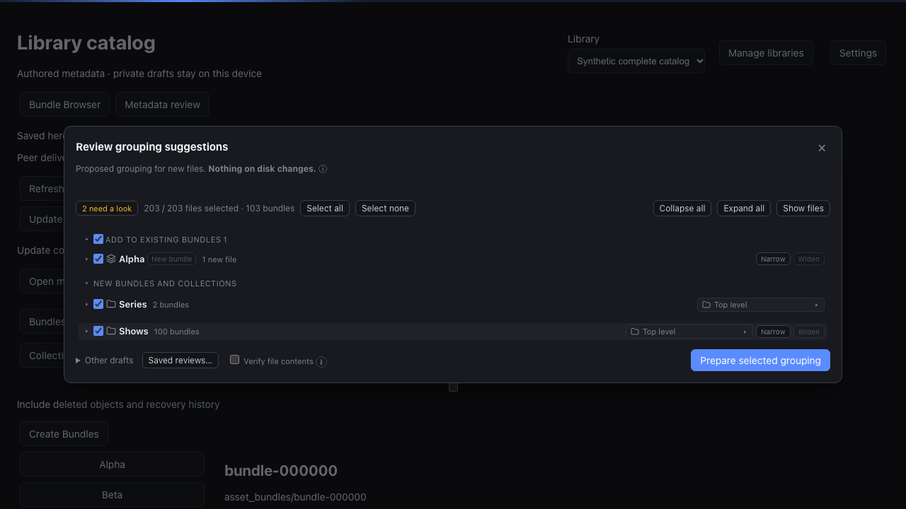

# Manual replica Update

Format-three libraries advertise `discovery_version: 1`. **Update** starts a
private, cancellable job against the serving device's library root. Normal
metadata exchange remains automatic. Earlier formats retain their existing
capabilities; old libraries use the [reviewed conversion workflow](replica-migration.md).

In the bundle browser, **Update** sits at the top of the sidebar. The sidebar says
when discovered files wait for review; that notice and **Review Discoveries…** in
the ⋯ menu open the review as a dialog. As v0.2.1's grouping review did, the
review also opens by itself when an Update this window started finishes and
leaves discovered files to decide; an Update that leaves nothing to decide only
reports its result. Metadata review keeps Update, Review discoveries and the
last run's status above its editors.

Creating a new library also schedules initial private discovery after its
workspace is ready. Its pending files remain available for review, without
opening the grouping dialog automatically. Registration and ordinary reopening
do not schedule a scan. Native creates retain their request across the server
switch, scoped to the intended server and library.

The footer names the current phase. Finding files reports the count found so far
with an indeterminate bar. Catalog checks, moved-file checks and grouping indexes
show completed/total with a determinate bar. Grouping and
preparing suggestions show their phase with an indeterminate bar. These are
phase totals, not a whole-Update time estimate. Counts commit with each worker
batch and restart from enumeration after interruption. Cancellation remains
available throughout.

## Review and identity

Update observes existing paths, repairs unambiguous external moves and proposes
new files using the existing grouping rules. Pending files and grouping suggestions
remain private until **Prepare selected grouping** and **Accept reviewed grouping**.
Servers without editable grouping retain the earlier candidate review controls.
Review can change title, destination, selection and order. Additions append to a
confirmed bundle without regrouping its existing members or replacing its cover.
Unambiguous video/subtitle additions create authored subtitle links. Collection
review includes selectable descendant groups and their required ancestors. A chosen
existing collection receives the selected subtree; additions preserve settled
collection membership unless placement is explicit. Accepted source receipts retain
unchecked siblings and remaining album files for later review. Remaining files from
a partially accepted group append to its settled bundle by default.

Candidate files, descendant groups, prepared sources and metadata values have
independent pages. Selection defaults to the complete candidate, with file/group
exceptions and order edits independent of the visible page. Existing explicit-list
drafts remain recoverable. Preparation exposes complete file/group counts, actual
collection placement and exact metadata before acceptance.

A successful automatic repair preserves the file ID, bundle membership, notes,
tags, moments, covers and subtitle relationships. It requires the original path to
be absent, unique matching evidence in both directions and an earlier local
observation of that same original catalog path. Receiving a peer's moved path
cannot authorize moving it back to an older local folder. Copies with a surviving
original are new files. Multiple matches, sample-only matches across different
physical files and identities with no prior local observation require explicit
review. Sample-only review states that complete equality is unproven.

Different evidence at a cataloged path requires an explicit replacement choice.
Competing accepted replacements expose **Review content identity** in the file
editor, with both retained evidence alternatives.
Detected replacement bytes cannot inherit that identity's playback state before
review. Local absence, incomplete reads and unavailable roots never delete shared
catalog entries. No discovery operation renames, moves, overwrites or deletes media.

## Editable grouping review

The private store now contains an editable draft graph, separate from immutable
candidate and prepared-review tables. Its API and lifecycle worker are wired;
the application opens its paged tree when `grouping_version` is at least 1.
Current qualification is recorded in [STATUS](STATUS.md). Its `grouping_*` tables
retain logical placement independently of
physical source directories, file selection, folder display choices, per-folder
stem levels and exact edit receipts. The revision counter guards concurrent edits;
it does not version the library format.

Rename and drag commands change private rows only. Narrow/Widen prepares bounded
planner pages for the chosen folder before replacing that folder's suggestions
atomically. Bundle-to-collection conversion splits video subjects with strict
sidecar matching within each source folder; repeated filenames in separate
folders remain independent. A one-subject subfolder keeps its folder title.
The inverse keeps file identities and folder display choices.
Cached regrouping now advances copying and planning by up to 32 steps or
50 ms per transaction, rather than committing each page or small subject
separately. Durable commits, the final atomic splice and reviewed acceptance
checks remain unchanged.
Recovery validates the graph and detects missing private decisions. Preparing a
graph exports its selected files, order and logical ancestors into an immutable
candidate, then uses the existing guarded discovery preparation and acceptance.
The graph stays frozen until its review is cancelled or accepted. Partial
acceptance removes only sources covered by that exact accepted receipt and
refreshes remaining staged bases only from its event and ancestry. Newer
competing edits remain stale for explicit review. Read-only collection context
keeps its captured name, lifetime and hierarchy bases.

The strict, paged API lives under `/replica/discovery/grouping`: workspaces,
revision-bound nodes/files/folders/stems, uncertain bundles, searchable move
destinations and idempotent edit commands. Opening a
workspace queues private initialization; request handlers never enumerate media.
The tree fetches only opened branches and requested pages and virtualizes its
visible rows. Loaded pages stay visible during edits, but controls wait until
fresh revision-bound pages arrive. Refresh restarts each loaded prefix with fresh
cursors, retaining later-page context without reusing stale page boundaries.
Expand all acts on loaded collections; its tooltip explains that later pages
remain explicit.
Show files also applies to newly requested pages, with individual folds retained.
Bundle rows summarize media kinds without downloading their file lists. Runs of
three or more matching sibling bundles fold into an expandable summary; uncertain
groups and existing-bundle additions remain individual. A run checkbox changes
only its displayed members, at most fifty per saved command. File drags temporarily
reveal individual targets without changing the Show files preference. Arrows
navigate from row controls as well as row whitespace; text editors retain their
normal keys. Rename keeps the clicked caret position. F2 renames from a row or
its controls; Enter renames only when the row has focus. Right-click or Shift+F10 opens the row
menu for rename, conversion and movement. The kind icon also converts the row.
Narrow/Widen appears only on the row representing a matching source folder.
File and proposal drags, keyboard move choices, file ordering and persisted
collection placement all change private draft rows only.

The need-a-look toggle appears only when suggestions are uncertain and pages them
across the complete draft, including folded branches. Filtering never changes
what Accept selects. The side view keeps identity repair, replacement and saved
prepared reviews reachable. Its category filter runs before server pagination.
Earlier grouping choices opens candidate drafts made before the editable tree.

Servers advertising `grouping_version: 2` show **Add to existing bundles**
above **New bundles and collections**. Both populations are filtered before
pagination. Collection counts and branch checkboxes cover only that tree;
Select all and Select none cover both
sections. Moving an addition into its own display section changes no accepted
collection membership. A section checkbox selects its additions only when the
whole section is loaded and fits one command (at most 50 suggestions); larger
sections retain individual selection and global Select all/none. Older servers
retain their mixed tree. Full-content verification remains optional; its tooltip
explains that it reads every byte.
**Other drafts** appears only when another draft or page is available. The side-view
entry names the available work: File changes, Saved reviews, or both. Ordinary
grouping candidates remain reachable through Earlier grouping choices. The file
change query filters before pagination. Reopening after a newer Update waits for
a fresh draft list before choosing the draft. Longer explanations are available
on demand.

The synthetic example keeps an addition to an accepted bundle above the new
collection suggestions. Changing their display does not move source files.

### Conversion timing

Synthetic local-disk measurements in Cairndex macOS compare one fresh run per
size before and after batching. They include private worker transactions and
status reads, but exclude UI polling, the worker's scheduling pause and shared
metadata transport. Every subject has one generated video-shaped file and one
subtitle-shaped file; no decoder or owner data is involved.

| Selected files | Bundle to collection, before / after | Durable worker steps, before / after |
| --- | ---: | ---: |
| 4 | 0.244 / 0.082 s | 13 / 3 |
| 200 | 5.190 / 0.211 s | 221 / 9 |
| 420 | 9.891 / 0.724 s | 454 / 17 |

The reverse conversion takes about 0.06 / 0.13 / 0.32 seconds for those sizes.
These timings establish the cached-planner improvement. A separate real-server
browser run on the same VM measured 1.549 seconds for collection to bundle and
3.691 seconds for the 200-file reverse conversion, from clicking until the saved
summary and controls returned. Assertions polled every 50 ms. Before Update
batching, its 203-file Update took 44.323 seconds, followed by 6.362 seconds to
reopen and initialize review.

A separate in-process 200-file Update measurement fell from 10.986 to 1.264
seconds after cached indexing, grouping and export shared a bounded transaction.
Write transactions fell from 355 to 29; filesystem enumeration, known-file
validation and repair retained their existing boundaries. Both runs use 100
synthetic video/subtitle pairs, include status reads and exclude worker pauses,
UI polling and metadata transport. These single local runs do not establish
network-share or media-probing cost.
The real-server 203-file browser journey passes after this change: Update takes
8.713 seconds and review initialization 7.558 seconds. The same run measures
1.882 seconds to merge and 3.125 seconds to split its 200-file grouping. Selection,
accepted identities, collection placement and unchanged source bytes are checked.

Optional complete-content verification operates on the immutable exported graph
before review preparation. Its byte progress and cancellation remain available
after reopening the dialog. Cancelling verification or returning from a prepared
review retains the editable draft. A newer Update does not discard earlier
retained grouping choices; the owner can choose that run explicitly.
Recovery pauses queued and running grouping edits with their original phase,
cursor and intent intact. Resume retained grouping edit retries that exact
operation. Merely reopening a recovered library never submits the edit.

## Evidence and limits

An ordinary scan touches at most three 64 KiB regions per file. Files up to 192 KiB
receive a complete SHA-256; larger files initially receive `sample-sha256-v1`.
Samples cannot detect changes outside those regions or prove equality of independent large copies.
Automatic sampled repair also requires the earlier local device/inode identity.
Generation-bound local resume follows a verified repair; a manual sample-only
identity assignment does not transfer old progress to a different physical file.

**Verify complete content** explicitly queues full SHA-256 reads for an immutable
candidate. The worker reads 1 MiB blocks, yielding after at most 8 MiB or roughly
50 ms of reads. Byte progress and cancellation remain private. Complete receipts
survive cancellation; an interrupted file restarts from byte zero. A pinned
source descriptor and a final path/generation check reject files changed during
hashing. Reading a full file is never part of a request handler or ordinary scan.

Complete identities derive from library/epoch, path and evidence, so independently
verified identical large copies can share a file ID after reviewed acceptance.
Unverified large-file IDs are random and persist in a private path/evidence mapping.
A full-evidence identity observed through local samples requires verification;
matching samples alone cannot establish equality. Retained samples find possible
moves of previously verified files, with complete evidence checked before repair.
Independent large discoveries and same-path different contents retain explicit causal identity conflicts with a
valid local display. Group IDs derive from selected file IDs. Initial group/file
timestamps use the earliest selected source modification time: preserved copied
mtimes converge, while different mtimes can produce ordinary timestamp conflicts.
Timestamps never establish ancestry or authorize a move.

Enumeration yields every 32 entries, including ignored hidden/symlink entries.
The worker starts its next pass after 25 ms while a run, review, verification,
grouping edit, catalog job or unpublished event is queued, and after 1 second when every open
library is idle. Each pass keeps the bounded steps, so Release drains promptly.
Private disk-backed planning indexes every fresh source and settled catalog owner
before classifying complete directories. Assignment and role work advances in
32-file batches; worker batches never split bundles or omit later-page owners.
Cached indexing, grouping and candidate export share one transaction for at most
32 steps or 50 ms. Phase and cursor updates commit with those rows. Failure rolls
back that batch; cancellation takes effect between batches. This reduces durable
flushes without changing SQLite settings or moving filesystem work into the batch.
Preparation stages selected files, relationships and original causal bases in
private tables and emits complete linked catalog payloads. Final catalog validation
and activation are atomic operations; complete membership/forest units and the
final source-generation check may take longer than a batch. No measured
multi-terabyte readiness claim is implied. Continuous watchers, provider hydration
and directory-browser pagination remain outside this workflow.

## Private work and recovery

Still-unconfirmed catalog files remain eligible for grouping. Their fresh local
observations carry the existing file ID and opening path, lifetime and membership
bases. Preparation refuses a later confirmed boundary or changed arrangement.
Acceptance moves these existing identities through disk-backed arrangements,
including dependent moments and subtitle selections, rather than creating new
file rows. A complete provisional source can supply the resulting bundle's ID,
notes, rating and other metadata. Empty sources with independent notes, ratings,
extra metadata or collection/tag membership cannot be silently removed; keep them
as separate groupings. Existing selected covers and subtitle choices survive.
Only newly discovered files receive new identities. The same reviewed catalog
validator and exact retry receipt cover the complete change.

Progress, errors, observations, missing-file candidates, grouping drafts, identity
mappings and exact prepared reviews live in the private DB. Completed scans
supersede obsolete suggestions while retaining their bodies and saved drafts.
Cancelled or failed work retains already committed repairs. A failed or cancelled
walk cannot publish a repair; a restarted walk discards its partial observations.

Preparation captures source generations and causal bases. Acceptance revalidates
sources in pages, checks their generations again immediately before committing,
and commits authored changes and the private receipt atomically. An exact
retry retains its original preview and never silently takes newer bases. Competing
offline choices become catalog conflicts; a competing grouping received before
acceptance can instead fail safely while retaining the full private preview.
Closing/reopening review, switching libraries or refreshing the catalog preserves
private drafts. Invalid browser draft bytes are retained with a visible error.

[Private recovery](replica-recovery.md) includes every discovery table and validates
candidate shapes, identities, causal references and acceptance receipts. Restored
observations require local revalidation. **Saved discovery reviews** retains the
original selection and preview. **Revalidate saved review** checks that exact intent
without submitting it. Changed source generations require Update and a fresh
review; unchanged sources can be explicitly accepted after revalidation. Nothing
recovered applies itself. Normalized candidate members, group context, staged
values, linked preview parts and accepted-source receipts are included in recovery.
Recovered full-verification jobs require explicit retry; complete cached receipts
become trusted only after local generation checks. Incomplete hash accumulators
are rebuilt. Older backups missing whole additive discovery families remain
supported; partial or unknown schemas require an upgrade.

## API

All routes are under `/api/v1/libraries/{id}/replica/discovery`:

| Route | Behavior |
| --- | --- |
| `GET /status` | Latest private job state, phase, observed/repaired counts and error |
| `POST /runs` | Enqueue with a stable operation ID; repeated active requests reuse the run |
| `DELETE /runs/{id}` | Cancel future worker steps |
| `GET /candidates` | Paginated pending suggestions |
| `GET /candidates/{id}/files`, `GET /candidates/{id}/groups` | Page through complete sources and descendant/ancestor context |
| `GET /candidates/{id}/choices` | Page through every missing-identity choice; retain the selected label independently |
| `POST /reviews` | Queue complete selection preparation or exact-intent revalidation |
| `GET /reviews`, `GET /reviews/{id}` | Saved reviews, durable progress and exact compact preview/receipt |
| `GET /reviews/{id}/pages/{kind}` | Page through prepared `files`, `groups` or metadata `changes` |
| `POST /reviews/{id}/accept` | Queue acceptance of the exact receipt |
| `DELETE /reviews/{id}` | Cancel an uncommitted review while retaining its bytes |
| `POST /verifications` | Explicitly queue full-content verification of a candidate |
| `GET /verifications/{id}` | Read file/byte progress and retained errors |
| `DELETE /verifications/{id}` | Cancel future reads while retaining completed evidence |

HTTP handlers never enumerate media or apply grouping. Discovery shares the
existing replica worker and Release drain; its private state never enters metadata
transport. [ADR-0032](adr/0032-replica-discovery.md) defines the capability boundary.
