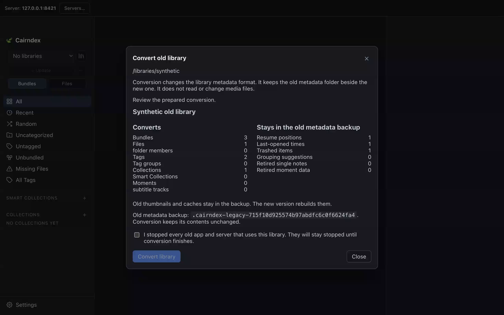

# Library conversion

## Owner workflow

[ADR-0038](adr/0038-legacy-library-conversion.md) adds an explicit conversion
path for old `cairndex.library` version-one packages. It amends ADR-0035.
Normal Open still refuses those packages. Conversion never runs automatically.
`CONVERSION_AVAILABLE` is `True` for this reviewed path. The application keeps
one portable metadata model after conversion.

1. Stop every old app and server that uses the library. Finish any interrupted
   file operation in the old version first. Keep the writers stopped until
   conversion completes. Back up source media separately.
2. Open **Libraries**. Enter the old library root in **Add library**. An existing
   old registration has a **Convert** button. On desktop, use the typed server
   path for conversion; the native folder picker still handles Create/Open.
3. Select **Inspect library**. Inspection reads only the old metadata. A fresh
   ownership lease, unknown metadata entry, unknown schema or interrupted source
   operation blocks conversion. The report lists what converts and what stays
   in the old metadata backup.
4. Select **Prepare conversion**. The worker copies the quiescent DB, WAL and
   rollback journal into private storage. SQLite recovers and validates this
   copy. The original database is never opened in place. Known older schemas
   receive their historical additive defaults. Preparation reconstructs an
   independent portable catalog and exports it to compare every authored cell.
   Nothing in the library folder changes.
5. Review the report and backup folder name. Confirm that every old writer
   stopped, then select **Convert library**. Activation uses that exact review
   receipt. It checks the source again before and after staging. A fresh lease
   always blocks; confirmation is required for a stale or unreadable lease.
6. Conversion stages new metadata in `.cairndex-conversion-<attempt>`. It renames
   the original folder to `.cairndex-legacy-<attempt>` without changing its
   contents. The staged folder becomes `.cairndex`. No-replace renames refuse
   occupied names. The library registers as format three, or its old registry
   row changes in place. Conversion leaves it released and resets an old
   source-write opt-in. **Open converted library** explicitly reopens it.

Bundles, files, IDs, relative paths, authored values and relationships convert.
Resume positions, last-opened times, grouping suggestions, retired single-note
and moment data, old caches and old trash stay in the backup. The old passphrase
hash also stays there. Set access protection again on each serving instance.
Media files are never read, copied, renamed, moved or deleted by conversion.



This review uses invented library metadata in a disposable container. It shows
the conversion counts, retained metadata and required writer-stop confirmation.

## Retry and Undo

Conversion runs as durable server tasks. Closing a read-only preparation dialog
keeps its task running. **Resume conversion** in Libraries reads the same task.
The browser keeps operation IDs and dialog visibility for the selected connection. Paths, review
receipts and results remain on the server. A lost reply is resolved by reading
that operation, rather than starting another swap.

After a restart, interrupted activation and Undo recheck and continue their exact
step. Interrupted preparation requires a new attempt. **Retry conversion** or
**Retry Undo** retries the accepted task. Create, register and Open refuse an
active conversion or a stopped swap with missing metadata. They cannot create a
replacement library in the gap between renames. The worker runs one conversion
step at a time and accepts one active step per root on this server.

Release the converted library on every server before **Undo conversion**.
Undo restores the old `.cairndex` folder and retains the converted folder as
`.cairndex-converted-<attempt>`. The server keeps its private store and binding
under the private attempt's `retired/` directory. New metadata edits and private
work are retained. Undo does not merge them into the old library and does not
reverse later source-file operations. A completed Undo does not rewind later
legacy edits. Its activation cannot run again; another conversion needs a new
attempt. Old applications refuse the converted descriptor.

Keep both metadata folders and private server data until their recovery value is
no longer needed. They are not complete source-media backups. Conversion does
not automatically remove them.

## Compatibility and qualification

Format-three portable packages need no legacy conversion. Known private SQLite
upgrades remain additive and retain package identity and authored history.
Formats one and two of `cairndex.replica-library` have separate capability
contracts; changing a descriptor does not promote them. Unknown or partial
layouts fail closed. The old workspace remains unavailable in the new app.
Pre-grouping schemas with missing required columns are refused. Qualification
covers actual v0.2.1 metadata and the earlier playback-progress schema; it does
not establish support for every historical build.

All known writers must stay stopped. Simultaneous conversion from independent
servers is not qualified. Local POSIX and authenticated mounted-SMB no-replace
publication use the existing storage adapters. Provider delivery, representative
scale and power-loss durability require separate qualification. See
[STATUS](STATUS.md) for actual checks and the owner-test checkpoint.

## Developer fixture preparation

Run from `apps/server`:

```python
from cairndex.devtools.catalog_fixture import create_disposable
from cairndex.replicas.catalog.migration import prepare
from cairndex.replicas.catalog.conversion import export_legacy

fixture = create_disposable()
prepared = prepare(fixture)
assert prepare(fixture).package == prepared.package
rollback = export_legacy(prepared)
```

Preparation records a private immutable intent containing the source checkpoint
and one epoch. It validates the actual SQLite schema, schema version, relationships,
manifest, private records and source-operation journal. Unknown data stops work.
Pending operations and unresolved Trash recovery stop work; they are not replayed.
The original source remains authoritative and unchanged.

SQLite backup captures committed WAL values from the quiescent fixture. The
private archive retains both databases, exact manifest and synthetic access record
with checksums. Every modeled table is preserved, including private plans,
observations, progress, cursors and operation recovery records. Exact authored
values produce linked immutable seed objects. A separate private catalog imports
all dependencies. A legacy export must match every original row and cell before
the candidate descriptor is published. IDs, paths, relationships, null/empty
values, ordered notes, numeric values and opaque JSON text remain intact.

Format three requires catalog version 2, minimum reader 3 and the complete
`discovery_identity_v1` capability set. Preparation generates this catalog; it
does not relabel a format-two package. It does not copy source media into the
candidate. Native qualification uses separately copied synthetic media only.

One process lock excludes competing preparations. Process exits retain incomplete
attempts. Retry checks the same source checkpoint and uses the same epoch in a new
attempt. An acknowledged completed retry validates and reuses its original result.
Changed source, archive, seed or receipt data require inspection. No attempt or
recovery copy is automatically removed. Power-loss durability is not established.

### Fixture export

Before edits, `export_legacy()` produces a separate exact legacy metadata copy.
After edits, it exports the last valid authored arrangement and retains complete
new private history, rejected branches, drafts, jobs and receipts in
`replica-recovery.db`. It checks references and database integrity. It does not
replace the source or activate a legacy application. Recovered jobs and drafts
must not be submitted automatically. The all-family catalog tests include conflict
choices, deletion/recovery and exact save retries.

The original media remains in its original root. A rollback export is metadata,
not a complete media backup. Unsupported new mappings must stop a real rollback.
The synthetic exporter uses fixture defaults for newly created file/bundle
observations; this is not approved behavior for an owner conversion.
